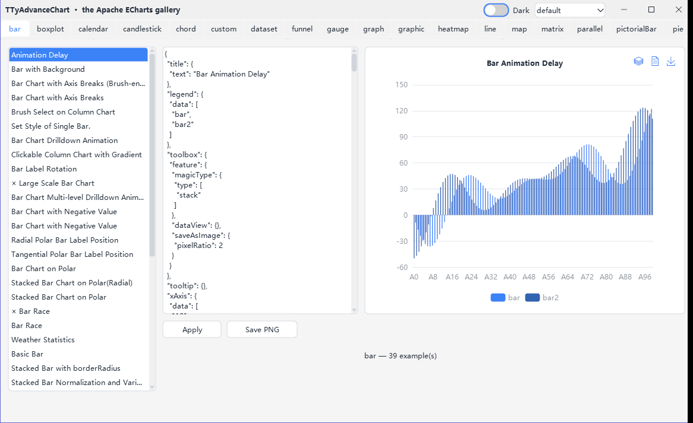
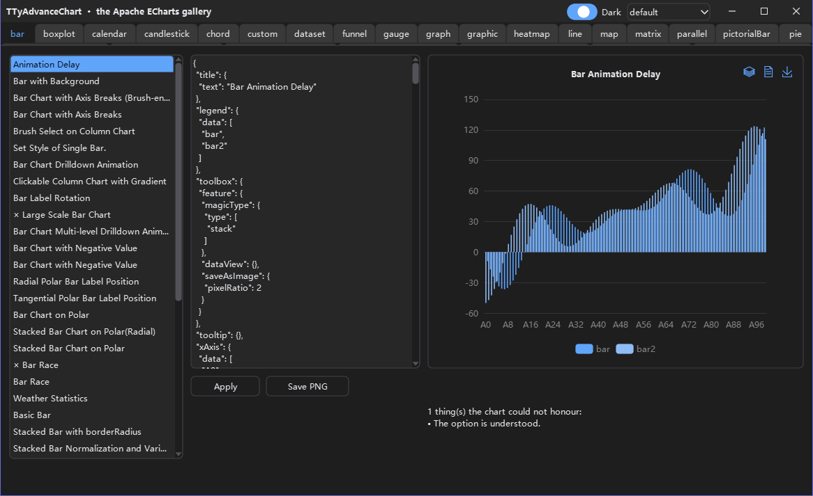

# TyAdvanceChart

`TTyAdvanceChart` is a chart control for Lazarus that draws the way Apache ECharts 6.1 does. Its configuration is an ECharts option, written as JSON text in the `Option` property.

It is an add-on package for [TyControls](https://github.com/ACTom/TyControls): it is drawn with BGRABitmap, and its axes, text and tooltips follow the TyControls theme.

> **中文:** [README.md](README.md) · **Changelog:** [CHANGELOG.en.md](CHANGELOG.en.md)



| Light | Dark |
|---|---|
|  |  |

---

## Features

- **ECharts options work as they are**: the ECharts option reference, the official examples and answers found online all apply.
- **Series**: line, bar, pie, scatter, effect scatter, candlestick, boxplot, heatmap, radar, gauge, funnel, pictorial bar, theme river, parallel, graph, chord, tree, treemap, sunburst, sankey, map, lines and custom series.
- **Components**: title, legend, tooltip, axis pointer, dataZoom, visualMap, toolbox, brush, timeline, graphic, dataset, markers, calendar, matrix, thumbnail and the aria description.
- **ECharts behaviour**: animation, merged updates, dispatchAction, events, connect and image export.
- **Checked item by item**: the same option runs in the real ECharts 6.1 under node; its layout, colours, events and animation values are compared with this control's.
- **Themed**: the chart follows TyControls' themes, skins and light/dark modes; colours and font sizes written in the option win.
- **HiDPI**: drawn in device pixels, and laid out again when the form moves to a display with another PPI.
- **Design time**: an option editor (syntax highlighting, completion from the option reference, the reference tree, live diagnostics) and a series and data editor.
- **English and Chinese UI**, translated with gettext `.po` files.

---

## Dependencies and versions

- Install TyControls first, then this project's packages.
- Until TyControls releases 4.0, this project depends on TyControls' `main` branch.
- When TyControls 4.0 is out, this project depends on TyControls 4.0 and releases its own 4.0, its first formal release.
- After that, this project's minor versions are its own, but it stays compatible with the latest stable TyControls.
- There is no formal release of this project before TyControls 4.0; its version stays 3.99.0 until then.

The other requirements are the same as TyControls': Lazarus 3.0+, FPC 3.2.2+ and BGRABitmap (the OPM package `BGRABitmapPack`). The supported platforms and widgetsets are the same as TyControls' too; see its [README](https://github.com/ACTom/TyControls/blob/main/README.en.md#supported-platforms).

---

## Installation

**1. Install TyControls**

Take TyControls' `main` branch and install `tycontrols_dt.lpk` as its README's "Quick start" describes.

**2. Install this project's two packages**

| Package | Contents |
|---|---|
| `tyadvancechart.lpk` | Runtime package: the control |
| `tyadvancechart_dt.lpk` | Design-time package: component registration, palette icon, option editor, series and data editor |

Open `tyadvancechart_dt.lpk` in Lazarus and click **Use → Install**; the IDE rebuilds and restarts. The runtime package `tyadvancechart.lpk` installs with it as a dependency.

**3. Use it**

`TTyAdvanceChart` is on the `TyControls Shapes & Charts` page of the component palette. Drop it on a form and click the "..." of `Option` in the Object Inspector to write the configuration.

Or create it in code:

```pascal
uses tyControls.AdvanceChart;

var
  Chart: TTyAdvanceChart;
begin
  Chart := TTyAdvanceChart.Create(Self);
  Chart.Parent := Self;  // on a TTyForm, put it on Surface
  Chart.Align := alClient;
  Chart.Option :=
    '{' +
    '  xAxis: { type: "category", data: ["Jan", "Feb", "Mar"] },' +
    '  yAxis: { type: "value" },' +
    '  tooltip: { trigger: "axis" },' +
    '  series: [{ type: "bar", data: [120, 200, 150] }]' +
    '}';
end;
```

---

## Example

[examples/advchart](examples/advchart/) loads the 244 configurations of the official Apache ECharts example gallery as they are, one page per category.

- Edit the configuration on the right and the chart redraws.
- What it cannot draw is listed, with the reason.
- It can save a PNG.
- The UI is in Chinese or English, following the system language; the title bar switches themes and light/dark.

Build: with the two packages installed, `lazbuild examples/advchart/advchart_example.lpi`.

The example ships only maps without national borders: the USA, Switzerland, Iceland and three SVG maps. The few examples that ask for the `china`, `world` or `HK` map say the map is missing; save a file under that name in `examples/advchart/maps/` and the example uses it.

---

## Documentation

| Document | Contents |
|---|---|
| [docs/advancechart.md](docs/advancechart.md) | API reference, in Chinese: usage, properties, events, function-valued options, images and maps, keyboard and accessibility, design time, HiDPI |
| [Differences from ECharts](docs/advancechart.md#12-与-echarts-的差异) | Section 12 of the same document |
| [CHANGELOG.en.md](CHANGELOG.en.md) | Changelog |
| [CONTRIBUTING.en.md](CONTRIBUTING.en.md) | Reporting problems, contributing code |
| [THIRD-PARTY-NOTICES.md](THIRD-PARTY-NOTICES.md) | Licences of third-party material |

---

## Themes

- The chart's tokens and theme keys are in `themes/advchart.tycss`.
- At start-up the package registers these styles in the base layer of the TyControls themes, so every built-in theme and skin carries them.
- Your own theme can override these tokens and keys the same way as for any other TyControls control.

The TyControls theme builder (`tools/themebuilder`) is a separate program and does not link this project. To make it know the chart's tokens and theme keys, either:

- copy `themes/advchart.tycss` into the `addons\` folder next to the theme builder's executable; it loads at the next start;
- or choose **Load add-on styles…** in the theme builder's **File** menu and pick `themes/advchart.tycss`.

---

## UI language

The chart has a translation catalogue of its own, separate from TyControls'. Add one line at start-up:

```pascal
uses ..., LCLTranslator;

SetDefaultLang('', LangDir);                                                        // your app
TranslateUnitResourceStringsEx('', LangDir, 'tycontrols', 'tyControls.StrConsts');  // TyControls
TranslateUnitResourceStringsEx('', LangDir, 'tycontrols_advancechart',
  'tyControls.AdvanceChart.StrConsts');                                             // the chart
```

To deploy:

- Rename `languages/tycontrols.advancechart.strconsts.<lang>.po` to `tycontrols_advancechart.<lang>.po`.
- Put it in the same `languages/` folder as TyControls' `tycontrols.<lang>.po` and your app's own `.po` files.
- The third argument must be `'tycontrols_advancechart'`, with no dot: LCL strips everything after a dot as an extension.
- The fourth argument is the real unit name, `tyControls.AdvanceChart.StrConsts`.

Full example: [examples/advchart/advchart_example.lpr](examples/advchart/advchart_example.lpr).

---

## Contributing

Report problems and ideas on [GitHub](https://github.com/ACTom/TyAdvanceChart/issues); see [CONTRIBUTING.en.md](CONTRIBUTING.en.md).

---

## License

Modified LGPL, the same license as TyControls, the FPC RTL, LCL and BGRABitmap: you may statically link the chart into closed-source commercial applications; modifications to this project's own source must be released under the same license.

Full terms: [COPYING.modifiedLGPL.txt](COPYING.modifiedLGPL.txt) and [COPYING.LGPL.txt](COPYING.LGPL.txt). The licences of the ECharts example configurations, the maps and the d3-geo port in the example are in [THIRD-PARTY-NOTICES.md](THIRD-PARTY-NOTICES.md).
