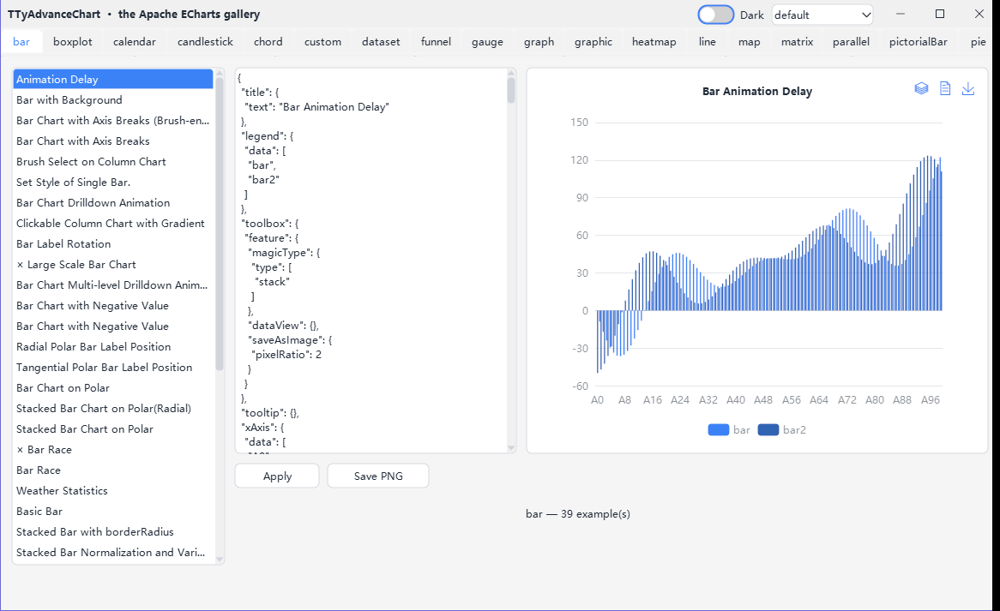
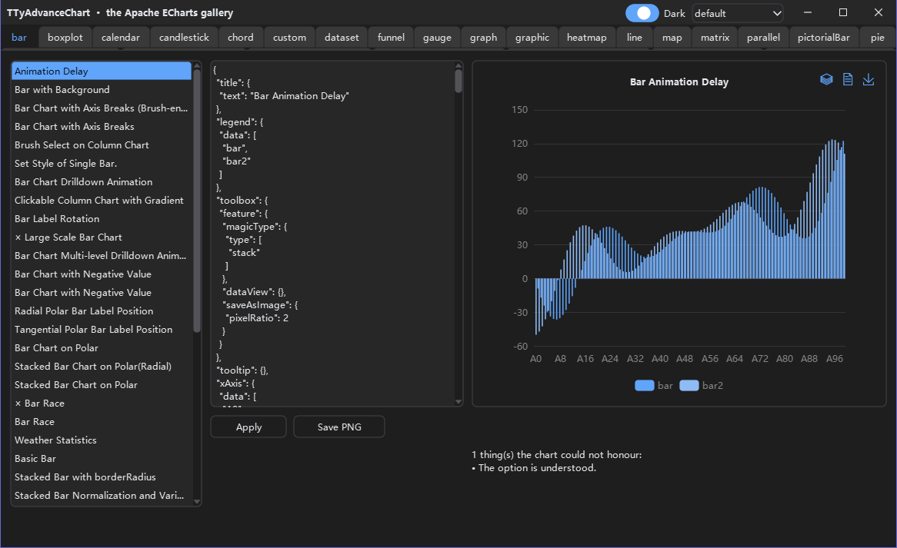

# TyAdvanceChart

Lazarus 图表控件 `TTyAdvanceChart`，照 Apache ECharts 6.1 画图。配置就是 ECharts 的 option，写成 JSON 文本放进 `Option` 属性。

它是 [TyControls](https://github.com/ACTom/TyControls) 的附加包：用 BGRABitmap 自绘，坐标轴、文字、提示框跟着 TyControls 的主题换肤。

> **English:** [README.en.md](README.en.md) · **更新日志:** [CHANGELOG.md](CHANGELOG.md)


| 亮色 | 暗色 |
|---|---|
|  |  |

---

## 特性

- **ECharts 的配置原样能用**：ECharts 的配置项手册、官方示例和网上的现成答案都能直接参考。
- **系列**：折线、柱、饼、散点、涟漪散点、K 线、箱线、热力图、雷达、仪表盘、漏斗、象形柱、主题河流、平行坐标、关系图、和弦、树图、矩形树图、旭日图、桑基图、地图、lines、自定义系列。
- **组件**：标题、图例、提示框、轴指示器、dataZoom、visualMap、toolbox、刷选、时间线、graphic、dataset、标注、日历、matrix、缩略图、无障碍描述（aria）。
- **行为照 ECharts**：动画、合并更新、dispatchAction、事件、联动（connect）、导出图片。
- **逐项核对过**：同一份 option 在 node 里跑真的 ECharts 6.1，取出布局、颜色、事件和动画的数值，再和本控件的结果比。
- **跟着主题换肤**：切换 TyControls 的主题、皮肤和亮暗时，图表跟着变；option 里明写的颜色、字号优先。
- **HiDPI**：按设备像素画，窗体移到 PPI 不同的显示器上时重新排版。
- **设计期**：option 编辑器（语法高亮、按配置项自动补全、配置项参考树、实时诊断），以及系列与数据编辑器。
- **中英文界面**，gettext `.po` 翻译。

---

## 依赖与版本

- 先装 TyControls，再装本项目的包。
- TyControls 发布 4.0 之前，本项目依赖 TyControls 的 `main` 分支。
- TyControls 发布 4.0 后，本项目改为依赖 TyControls 4.0，同时发布自己的 4.0。这是本项目的第一个正式版。
- 从那以后，本项目的次版本自己安排，但一直兼容 TyControls 最新的稳定版。
- TyControls 4.0 之前，本项目不发正式版，版本号一直是 3.99.0。

其他依赖和 TyControls 相同：Lazarus 3.0+、FPC 3.2.2+、BGRABitmap（OPM 包名 `BGRABitmapPack`）。支持的平台和 widgetset 也和 TyControls 相同，见它的 [README](https://github.com/ACTom/TyControls#支持平台)。

---

## 安装

**1. 装 TyControls**

取 TyControls 的 `main` 分支，照它 README 的「快速开始」安装 `tycontrols_dt.lpk`。

**2. 装本项目的两个包**

| 包 | 内容 |
|---|---|
| `tyadvancechart.lpk` | 运行期包：控件本身 |
| `tyadvancechart_dt.lpk` | 设计期包：注册组件、面板图标、option 编辑器、系列与数据编辑器 |

Lazarus 里打开 `tyadvancechart_dt.lpk`，点 **Use → Install**，IDE 重新编译并重启。运行期包 `tyadvancechart.lpk` 作为依赖一起装上。

**3. 用起来**

组件面板的 `TyControls Shapes & Charts` 页上多了 `TTyAdvanceChart`，拖到窗体上，在对象查看器里点 `Option` 的「...」写配置。

用代码建也可以：

```pascal
uses tyControls.AdvanceChart;

var
  Chart: TTyAdvanceChart;
begin
  Chart := TTyAdvanceChart.Create(Self);
  Chart.Parent := Self;  // TTyForm 上放进 Surface
  Chart.Align := alClient;
  Chart.Option :=
    '{' +
    '  xAxis: { type: "category", data: ["一月", "二月", "三月"] },' +
    '  yAxis: { type: "value" },' +
    '  tooltip: { trigger: "axis" },' +
    '  series: [{ type: "bar", data: [120, 200, 150] }]' +
    '}';
end;
```

---

## 示例

[examples/advchart](examples/advchart/)：Apache ECharts 官方示例库的 244 个配置原样载入，按类别分页。

- 右侧的配置可以直接改，改完重画。
- 画不了的部分照实列出原因。
- 可以存 PNG。
- 界面跟随系统语言显示中文或英文，标题栏上能换主题、切亮暗。

构建：装好两个包后，`lazbuild examples/advchart/advchart_example.lpi`。

示例只带不含国界的地图：美国、瑞士、冰岛，和三张 SVG。要用 `china`、`world`、`HK` 地图的几个示例会说明缺了地图；把同名文件放进 `examples/advchart/maps/`，示例就会用它。

---

## 文档

| 文档 | 内容 |
|---|---|
| [docs/advancechart.md](docs/advancechart.md) | API 参考：用法、属性、事件、函数型选项、图片与地图、键盘与无障碍、设计期、HiDPI |
| [与 ECharts 的差异](docs/advancechart.md#12-与-echarts-的差异) | 同一份文档的第 12 节 |
| [CHANGELOG.md](CHANGELOG.md) | 更新日志 |
| [CONTRIBUTING.md](CONTRIBUTING.md) | 报告问题、提交代码 |
| [THIRD-PARTY-NOTICES.md](THIRD-PARTY-NOTICES.md) | 第三方材料的许可 |

---

## 主题

- 图表的令牌和主题键写在 `themes/advchart.tycss`。
- 程序启动时，包把这份样式注册进 TyControls 主题的基础层，所以每个内置主题和皮肤都带着它。
- 自己的主题里可以改写这些令牌和键，写法和 TyControls 的其他控件一样。

TyControls 的主题编辑器（`tools/themebuilder`）是独立程序，不链接本项目。要它认得图表的令牌和主题键，二选一：

- 把 `themes/advchart.tycss` 复制到主题编辑器程序旁边的 `addons\` 文件夹，下次启动时自动载入；
- 或者在主题编辑器的「文件」菜单里点「载入附加包样式…」，选中 `themes/advchart.tycss`。

---

## 界面语言

图表有自己的翻译目录，和 TyControls 的分开。程序启动时多加一行：

```pascal
uses ..., LCLTranslator;

SetDefaultLang('', LangDir);                                                        // 应用
TranslateUnitResourceStringsEx('', LangDir, 'tycontrols', 'tyControls.StrConsts');  // TyControls
TranslateUnitResourceStringsEx('', LangDir, 'tycontrols_advancechart',
  'tyControls.AdvanceChart.StrConsts');                                             // 图表
```

部署时：

- 把 `languages/tycontrols.advancechart.strconsts.<语言>.po` 改名成 `tycontrols_advancechart.<语言>.po`。
- 它和 TyControls 的 `tycontrols.<语言>.po`、应用自己的 `.po` 放在同一个 `languages/` 目录。
- 第三个参数必须是 `'tycontrols_advancechart'`，不能带点：LCL 会把点号后面当扩展名剥掉。
- 第四个参数是真实单元名 `tyControls.AdvanceChart.StrConsts`。

完整示例见 [examples/advchart/advchart_example.lpr](examples/advchart/advchart_example.lpr)。

---

## 参与

问题和建议提在 [GitHub](https://github.com/ACTom/TyAdvanceChart/issues)，做法见 [CONTRIBUTING.md](CONTRIBUTING.md)。

---

## 许可

修改版 LGPL，和 TyControls、FPC RTL、LCL、BGRABitmap 相同：可以静态链接进闭源商业软件分发；修改本项目的源码时，修改部分要以同样的许可开放。

完整条款见 [COPYING.modifiedLGPL.txt](COPYING.modifiedLGPL.txt) 与 [COPYING.LGPL.txt](COPYING.LGPL.txt)。示例里的 ECharts 示例配置、地图和 d3-geo 移植代码的许可见 [THIRD-PARTY-NOTICES.md](THIRD-PARTY-NOTICES.md)。
